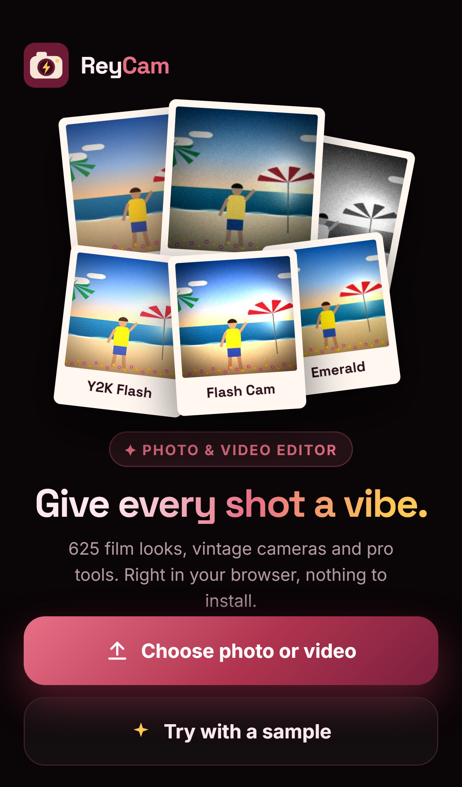
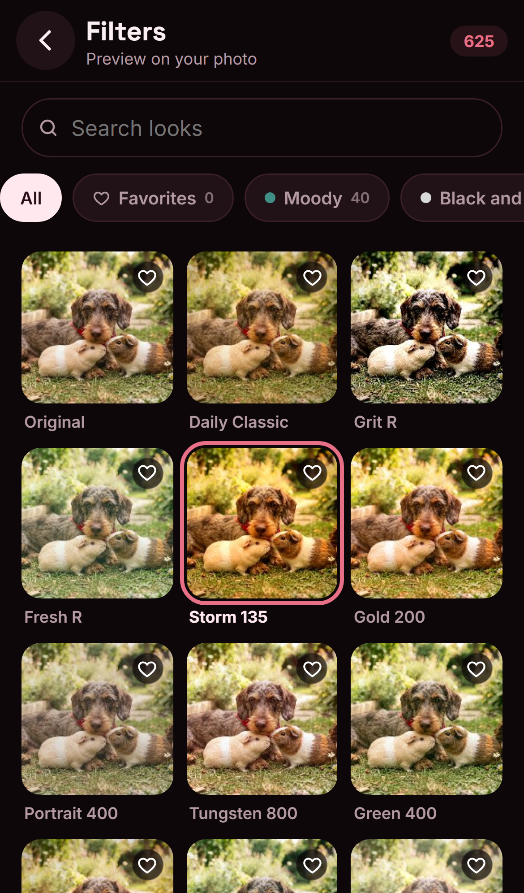
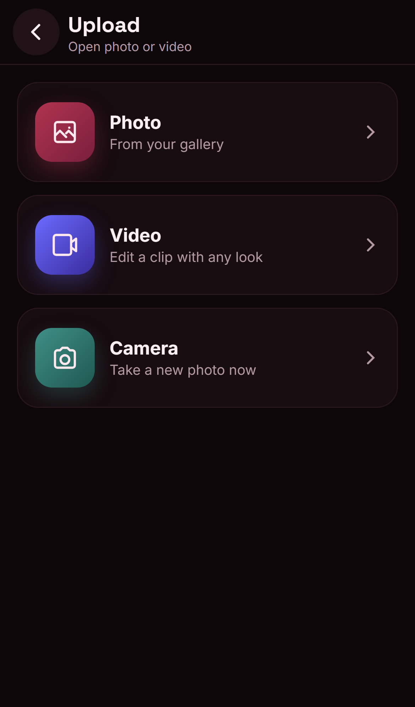
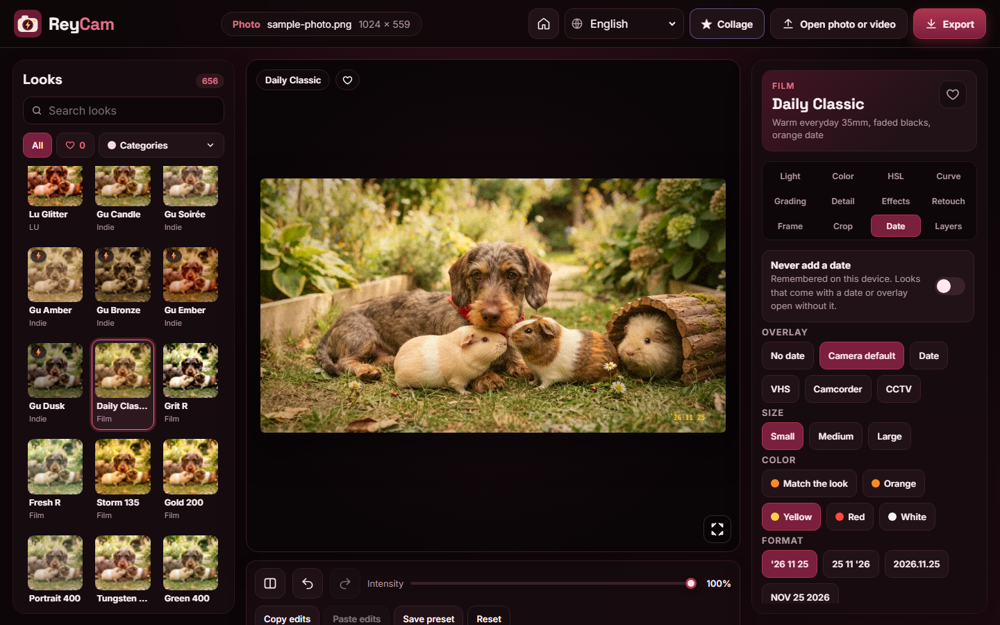
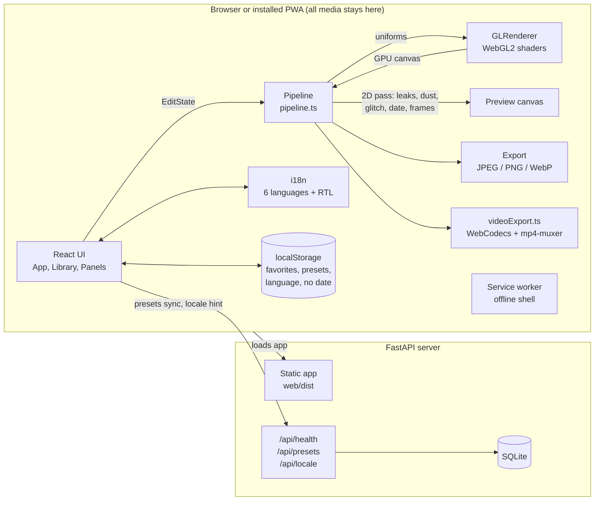
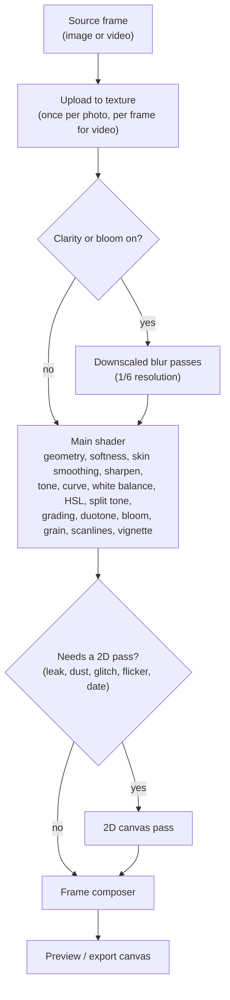

<div align="center">


# ReyCam

**Vintage cameras, film looks and pro edits for photos and videos, right in the browser.**

625 looks · 16 categories · GPU rendering with WebGL2 · Full resolution export · MP4 video with sound · Installable PWA · 6 languages


</div>

---

## Contents

- [Highlights](#highlights)
- [Screenshots](#screenshots)
- [Looks](#looks)
- [Architecture](#architecture)
- [Getting started](#getting-started)
- [Testing](#testing)
- [API](#api)
- [Privacy](#privacy)
- [Project layout](#project-layout)
- [Roadmap](#roadmap)
- [License](#license)

## Highlights

- **On device and private.** Every pixel is processed on the GPU of the user's device. Photos and videos are never uploaded.
- **625 looks in 16 categories** (every category has at least 39, Y2K has 50), including the new **Moody** category led by **Mirror Mood** (dark cinematic teal shadows with warm natural skin, fitted to a reference photo) and a **Black and White** category. Looks span film, Y2K, indie, flash, film simulations, low light, nature, yellow, green, wine and more. Each look has an intensity slider, and at 0% it matches the original.
- **Pro adjustments.** Light, parametric tone curve, color, 8 band HSL mixer, three way color grading, clarity, dehaze, sharpen, grain, bloom, light leaks, dust, chromatic shift, scanlines, glitch and lo fi pixels.
- **Camera details.** 10 frames (instant, film strip, slide mount, half frame, 8mm, cinema bars), date stamp in 4 formats and 5 colors, VHS, camcorder and CCTV overlays, double exposure.
- **"No date" everywhere.** A one tap option, plus a remembered setting for people who never want a date, even on looks that ship with one.
- **Instant preview.** The preview redraws in the same frame as the slider moves, and drops resolution only while dragging on slow GPUs.
- **Export.** JPEG, PNG or WebP at full resolution. MP4 (H.264 and AAC) processed frame by frame with WebCodecs, with a real time recorder fallback for older browsers.
- **Favorites, presets and workflow.** Heart any look, save your own presets, copy and paste edits, undo and redo, and hold to compare.
- **Automatic language.** Follows the phone or browser language, then a server hint, and can always be changed by hand. English, Portuguese, Spanish, Mandarin, Hindi and German are fully translated, and right to left layouts work for Arabic, Hebrew, Persian and Urdu.
- **iPhone formats.** HEIC and HEIF photos open everywhere: Safari decodes them natively and other browsers convert them on the device to a full quality JPEG (with the photo's rotation). iPhone `.mov` videos open wherever the device can play HEVC, with a clear tip when it cannot.
- **Built for phones.** A welcome screen, three big bottom buttons (Filters, Edit, Upload) that open full screen pages, a quick filters strip, one tap shortcuts, sliders docked under the photo, and support for iPhone notches and Android gesture bars.
- **Installable PWA** with an offline app shell.

## Screenshots

### Welcome screen

The app opens on a home screen with a floating collage of looks, a short pitch and two buttons: **Choose photo or video** or **Try with a sample**. Tapping the ReyCam logo in the editor brings it back.

<table>
<tr>
<td width="70%"></td>
<td width="30%"></td>
</tr>
</table>

### Phone app (iOS and Android)

On phones the editor works like a native photo app: the photo gets the space, with three big buttons at the bottom (**Filters**, **Edit**, **Upload**). Each button opens its own full screen page. The home view also has a **Quick filters** strip and **shortcuts** (Auto, Light, Color, Crop, Frame, Date).

<table>
<tr>
<td width="25%"><br/><sub>Editor (iPhone)</sub></td>
<td width="25%"><br/><sub>Filters page: every look previewed on your photo, categories on top</sub></td>
<td width="25%"><br/><sub>Edit page: pick a tool</sub></td>
<td width="25%"><br/><sub>Sliders docked under the photo, with Done</sub></td>
</tr>
<tr>
<td width="25%"><br/><sub>Upload page: photo, video or camera</sub></td>
<td width="25%"><br/><sub>Editor (Android, Pixel 7)</sub></td>
<td width="50%" colspan="2"><br/><sub>Top: Original, CCD 2003, Indie Sleaze. Bottom: Red Wine, Instant Flash (instant frame), VHS Tape (overlay).</sub></td>
</tr>
</table>

| Date panel with color and "Never add a date" | Compact category menu with favorites |
| --- | --- |
|  |  |

| Export dialog | Black and white look |
| --- | --- |
|  |  |

> Screenshots are captured from the running app with Playwright. The welcome, phone and desktop editor shots use [`docs/screenshots/sample-photo.png`](docs/screenshots/sample-photo.png) as the uploaded photo. The older look and panel shots come from [`web/tests/screenshots.mjs`](web/tests/screenshots.mjs).

## Collage

The **Collage** category (Portuguese: **Colagem**) turns a photo into a scrapbook or zine page: the person is cut out on the device, a photo treatment is applied, and the result is placed on a styled background with stickers and hand drawn doodles. Every element can be moved, pinched, rotated, recolored, duplicated, flipped, locked, reordered and deleted, and every color comes from named color slots that the Colors panel edits all at once.

- **110 built in templates**, filtered by Stars, Booth, Paper, Doodle, Retro Desktop, Duo, Comic, Scrapbook, Halftone and Nature. Set 1: Star Confetti Booth, Candy Stripe Booth, Cherry Print, Ransom Letters, Red Star Overlay, Crayon Split Duo, Paper Stars Night, Sky Silhouette Split, Doodle Stars Print, Retro Desktop Dialog, System Warning 3D, Retro Paint Frame, Love Wall, Starburst Postcard, Chalk Outline Crew, Ribbon Swirl, Cobalt Duotone Pop and Zigzag Rays. Set 2: Head Bangers, Magazine Profile, Holo Star Frame, Fairy Chase, Forest Elf, Felt Quilt Day, Meet the Artist, Bed Diary, Pink Scribble, Blue Sticker Face, Sunburst Pop, Sketch Aura, Graffiti Night, Memory Halftone, Journal Spiky, Comic Burst, Pattern Patch, Neon Painted, Paint Window Swirl, Desktop Corner, Green Flash Stars, Lime Contact Strip, Eye Strips, Retro Desktop Stack, Blue Monitor Grid, Star Sticker Booth, Sun Doodles, Camera Screen Night, Star Crown, Ribbon Wave Red, Train Diary, Rock Star Poster, Torn Yellow Marker, Sun Rays Party, Couch Sticker Party, Scrapbook Bedroom, Blue Street Board and Blue Burst Zine. Templates take 1 to 5 photos; missing photos reuse the first one. Set 3 (57 to 110, in [`templates-set3.ts`](web/src/collage/templates-set3.ts)) adds party walls, booth strips and grids, film negatives, contact sheets, punched paper, dot and line ornaments, face mosaics, compact camera mockups, frosted glass and riso posters.
- **Tools from set 3** ([`effects2.ts`](web/src/collage/effects2.ts)): photo slices (barcode strips, torn strip shuffle, pixel tiles, glass shards with glitter edges), light leak and prism, grunge paint panels, feature mosaic, dot matrix and line ornaments, punch outs (scattered stars and spirals, oval or star window panels), torn ink threshold patches, frosted glass shapes, crayon face doodles placed on each face, camera playback screen, compact camera mockup, color swatch card, rough white frames, film edge text, double exposure blend, RGB split glow, head portal (soft oval window with vignette), halftone ink strokes, zebra fur, stained glass, tile wall and grunge note backgrounds, and a riso print finish.
- **Filter pairing** ([`filters.ts`](web/src/collage/filters.ts)): after picking photos, a sheet asks "Do you want to use a filter too?" with Use recommended filter, Choose another filter and No filter. The filter is a ReyCam look rendered on each photo slot before the template treatment (70 percent by default), skipped on one or two tone treatments, never on stickers, text or interface elements. It can be changed, dosed or removed in the Photo tab, and the last choice is remembered per template. The recommended Lu filter for each template is in the pairing table; that option turns on as soon as a look with that id (for example `lu-haze`) is added to the looks.
- **Tools from set 2** (Stickers tab, usable in any collage): color block heads (a tinted square behind each head, per face color, size and offset), comic burst bubble, torn magazine page with fake print, sketch overlay from the photo edges with hatching, scribble fill that keeps the person clear, censor bar, crop windows (posterize, invert, tint, with crop guides), pattern patchwork inside the person, thread connectors with pins (uses Weave), photo layouts (grid, strips, contact sheet, filmstrip, torn edge dividers, scanlines), focus boxes, fake camera screen, retro windows and taskbar, liquid contour lines, crayon waves, sun rays, and new doodles (bolt, exclamation, spikes, sun, checker, splat, squiggle, X, circle mark, crown, loops, viewfinder corners).
- **Body features without a second model**: faces, eyes, mouth, hands and feet come from the person mask ([`detect.ts`](web/src/collage/detect.ts)), so face crop zoom, color block heads and focus boxes stay offline. Each photo layer can focus its crop on one of them.
- **Sticker library** ([`stickers.ts`](web/src/collage/stickers.ts), all original drawings, no logos): felt quilt kit (sun, moon, cloud, tree, bee, ladybug, snail, bunny), nature cutouts (goldfish, apple, butterfly wings, mushroom, moss rock, river, tree, pressed flower, tulip sketch) and a sticker pack (plush, sequin, embroidered, chrome and smiling stars, starfish, butterfly, clover, cassette, boombox, dice, cap, headphones, vinyl, compact camera, lips, push pin, ticket, sneaker, planet and more). Any sticker can get a white cut edge or a neon outline.
- **On device cutout** with the MediaPipe Image Segmenter (selfie segmenter, about 250 KB). The model and the WebAssembly runtime ship in `web/public`, so it works offline and photos never leave the device. Refine with restore and erase brushes, a lasso, brush size, softness and zoom.
- **Cutout styles**: clean, paper sticker (outline 0 to 60 px, rough edge, shadow), torn paper, silhouette fill and shape window.
- **Treatments**: black and white, sepia, monotone, duotone, halftone (round or square dots), color overlay (multiply, screen, overlay, normal), warm film, flash, negative tint, posterize, invert, color grade and paint over (neon, ocean or sunset painting with line art and hatching), on the whole photo or only on the cutout. Frames: photobooth, 35 mm film print, Polaroid and white paper.
- **Backgrounds**: solid with felt, kraft, watercolor, grainy poster, recycled, folded, fabric, crumpled, notebook, newsprint, canvas or oil paint texture, stripes, split halves, crayon, painted sky, an original retro desktop scene, felt quilt, retro comic page, ghost repeat, sunburst rays, torn poster, journal pages and your own photo (blur, any treatment, paper texture on top).
- **Stickers and doodles**: holographic, pastel, metallic, pearl and puffy stars, paper stars, starbursts, doodle stars with offset outlines, sparkles, dots, swirls, hearts, embroidered patches, ribbons with the **Weave** tool (tap a segment to pass it behind the person), zigzag rays, **auto outline** around the subject, letter tiles, handwritten text, repeated word patterns and an original 90s style desktop kit (dialogs, icons, pointer, selection, toolbox, recycle bin, folder, paint window). **Scatter** places N stars around the subject while keeping the face clear.
- **Colors**: palette panel with every slot of the collage, a color picker (hue and saturation wheel, brightness, HEX, opacity, recent colors, eyedropper), 12 preset palettes, a shuffle that builds a harmonious palette from the photo, and per element overrides with a relink button.
- **Editor**: ratios 9:16, 4:5, 3:4, 1:1, 4:3 and free, layers panel with thumbnails, undo and redo (60 steps), snapping to the center, autosaved drafts in **My Collages** (IndexedDB), and **Remix** to switch template while keeping the photo and matching colors.
- **Export**: PNG or JPEG at 2160 px on the long side or the photo size when larger, no watermark, optional date stamp, saved to Photos in the native apps and shared or downloaded on the web.

Video collages are planned for a second phase.

### Adding a collage template

Templates are plain data in [`web/src/collage/templates.ts`](web/src/collage/templates.ts) (1 to 18) and [`templates-set2.ts`](web/src/collage/templates-set2.ts) (19 to 56), typed by `CollageTemplate` in [`types.ts`](web/src/collage/types.ts). Add an object to one of those lists, or start a new `templates-setN.ts` and concatenate it in `buildTemplates`:

1. Pick an `id`, a localized `name` (`{ en, pt }`), a `ratio`, filter `tags` and the number of `photos` (1 to 5).
2. Choose a preset `palette` from [`palettes.ts`](web/src/collage/palettes.ts) and override slots in `colors` with the hex values of your reference. List the slots the Colors panel should show first in `slots`.
3. Describe the `layers` from back to front. Positions are fractions of the canvas (`x`, `y` = center, `w` = width), so templates work at any size. Point every color to a slot (`{ slot: 'starPrimary' }`) instead of a fixed color, so palettes and the Colors panel can change it.
4. Use `photo` layers for prints and cutouts, `subject` layers to put the cut out person in front of something drawn over the same photo, and `behind: '<photo layer id>'` on a sticker to hide it behind the person.
5. For crops of a detected feature set `anchor` (`face`, `eyes`, `mouth`, `hands`, `feet`, `body`) and `zoom` on a photo layer. For several photos use a `layout` layer whose `cells` point to photo indexes. Template specific slots (for example `head1`) can be added to `colors`; give them a name in `SLOT_NAMES` in [`strings.ts`](web/src/collage/strings.ts).

No renderer changes are needed. A new tool is a layer kind in `types.ts`, a draw function in [`effects.ts`](web/src/collage/effects.ts) called from `render.ts`, an entry in `TOOLS` (how the Stickers tab creates it) and in `PARAMS` (which settings the editor shows) in [`tools.ts`](web/src/collage/tools.ts), and its labels in `strings.ts`.

## Looks

| Group | Examples |
| --- | --- |
| Film | Daily Classic, CP 35, NE 135, SR 135, Golf Pastel, KV 88, S 67, D Expired, 1998, CT 2F, Nostalgia, Hoga, Sprocket, Okak, FQS, Pola I, Inst Mini, Mono 400, Medium 120, Dispo 27 |
| Indie | Indie Sleaze, Indie Core, Overblown, Flash 2020, Blown Out, Bad Flash, Pink Blowout, Webcam 2020, Tumblr 2014, Bedroom Pop, Grunge 90 |
| Y2K | Y2K Flash, CCD Blue, CCD 2003, Glow Party, Digi 2000, Phone 2010, Myspace |
| Simulations | Vivid 50, Standard 100, Soft Portrait, Chrome Calm, Super Neg, Amber Neg, Cine Soft, Bleach, Fine Mono, True Color |
| Yellow | Honey, Sunflower, Amber 70, Lemon Pastel, Summer Sun, Mustard |
| Green | Emerald, Cold Forest, Mint, Retro Olive, Drugstore Green, Neon Green |
| Wine | Red Wine, Bordeaux, Cherry Noir, Rose, Merlot Film, Velvet |
| Flash, Low light, Nature, Colors, Video, Extras | Paparazzi, Neon Noir, Golden Hour, Ultra Violet, VHS Tape, Super 8, Fisheye, Prism, Night Vision and more |

Look names are original. Several looks are inspired by classic film stocks and popular retro camera apps, without using their names or logos.

## Architecture



### Render pipeline



**Key ideas**

- Every look is a *recipe*: plain numbers on the same scale as the user sliders. Effective value = recipe value × intensity + user edit, so looks and manual edits always combine predictably.
- The preview and the exports share one pipeline. Only the output size changes, so what you see is what you export.
- Video export seeks each source frame, renders it at full resolution and encodes it with its exact timestamp, so slow devices never drop frames. Audio is copied from the original file.

## Getting started

### Option 1: Python only (prebuilt app included)

Requires Python 3.9 or newer.

```bash
cd server
pip install -r requirements.txt
python -m uvicorn main:app --host 0.0.0.0 --port 8000
```

Open http://localhost:8000. Windows: double click `start.bat`. macOS or Linux: run `./start.sh`.

### Option 2: Docker

```bash
docker build -t reycam .
docker run -p 8000:8000 reycam
```

### Option 3: Develop the frontend

Requires Node.js 18 or newer.

```bash
cd web
npm install
npm run dev        # hot reload on http://localhost:5173, proxies /api to port 8000
npm run build      # checks translations, type checks and writes web/dist
```

### Android app (APK)

[`.github/workflows/android-apk.yml`](.github/workflows/android-apk.yml) builds **`ReyCam.apk`** on every push and attaches it to the latest **Android build** release. Open the APK on the phone, allow **Install unknown apps** for the browser or file manager, and install. Exports are saved to a **ReyCam** album in the gallery.

### iPhone profile (`.mobileconfig`)

[`docs/install/ReyCam.mobileconfig`](docs/install/ReyCam.mobileconfig) (also on the release and at `https://gutomadon.github.io/reycam/ReyCam.mobileconfig`) is an iOS configuration profile that adds ReyCam to the Home Screen with its icon, full screen. Open it in Safari, then go to **Settings → Profile Downloaded → Install**. It needs no computer and no Apple ID, never expires, and can be removed in **Settings → General → VPN & Device Management**. Regenerate it with `cd web && node scripts/make-mobileconfig.mjs [url]`.

### Install on iPhone from a link (recommended)

The app is published on GitHub Pages by [`.github/workflows/pages.yml`](.github/workflows/pages.yml) on every push: **https://gutomadon.github.io/reycam/**

1. Open the link in **Safari** on the iPhone (not Chrome).
2. Tap **Share** → **Add to Home Screen** → **Add**.

ReyCam gets its own icon, opens full screen like a native app, works offline after the first visit, and never expires. Share the same link with anyone to let them install it.

### Install on iPhone as a native app (IPA, no App Store)

An `.ipa` cannot be installed by tapping it on the iPhone: iOS only installs apps signed for that device. Use a computer and the steps below.

Every push to `main` runs [`.github/workflows/ios-ipa.yml`](.github/workflows/ios-ipa.yml) on a macOS runner. It builds the Capacitor iOS app with the ReyCam logo as the app icon, and publishes an unsigned **`ReyCam.ipa`** on the [Releases page](../../releases). In the native app, **Export saves photos and videos straight to the Photos gallery**.

1. Download `ReyCam.ipa` from the latest **iOS build** release.
2. Install [Sideloadly](https://sideloadly.io) on Windows or macOS (iTunes or Apple Devices must be installed on Windows), plug in the iPhone, drop the IPA in and sign in with your Apple ID.
3. On the iPhone, trust your Apple ID in **Settings → General → VPN & Device Management**, and on iOS 16 or later turn on **Settings → Privacy & Security → Developer Mode**.

With a free Apple ID the app has to be reinstalled every 7 days (AltStore can refresh it automatically). A paid Apple Developer account removes the limit and allows TestFlight.

To regenerate the icon and splash after changing the logo: `cd web && node scripts/make-app-assets.mjs`.

### Install on a phone

Phones need HTTPS for the gallery picker and file export (localhost is exempt on computers). Deploy the server behind HTTPS, or test with a tunnel such as `cloudflared tunnel --url http://localhost:8000`, then use **Add to Home Screen** (iOS Safari) or **Install app** (Android Chrome).

## Look lab

`web/tests/lab/run.mjs` renders looks with the real pipeline in Chromium:

```bash
npm run lab:counts
```
Shows how many looks each category has.

```bash
npm run test:looks
```
Fails when two looks have almost identical thumbnails.

```bash
npm run lab:mirror
```
Shows how close each Moody look is to the Mirror Mood reference (mean delta E per pixel).

HEIC photos open in every browser: Safari decodes them natively and other browsers load `heic-to` (LGPL-3.0) on demand.

## Testing

| Suite | Command | What it covers |
| --- | --- | --- |
| Translations | `cd web && npm run test:i18n` | Fails if any UI string or look description is missing in pt, es, zh, hi or de |
| API | `python -m pytest server` | Health, presets round trip, invalid payloads (400 and 413), `/api/locale` variants and country header |
| End to end | `cd web && npm run test:e2e` | Opening media (button, drag and drop, paste, JPEG, PNG, WebP, MP4, MOV, invalid file, HEIC), every look on a photo and a video, intensity, every panel and slider, undo and redo, presets, photo and video export checked with ffprobe, playback, "No date", automatic language, phone and desktop layouts, PWA, accessibility and console |
| Date color | `cd web && node tests/date-color.test.mjs` | Reads the pixels of the date for every color in the preview, the photo export and the video export, on desktop, iPhone and Android profiles |
| Screenshots | `cd web && node tests/screenshots.mjs` | Regenerates the images in `docs/screenshots` |

The browser suites use Playwright with the installed Chrome (`CHANNEL=chrome`) and expect the server on `http://localhost:8010` (change it with `BASE`). Test media is generated with ffmpeg into `web/tests/fixtures`.

## API

| Method | Path | Purpose |
| --- | --- | --- |
| GET | `/api/health` | Health check |
| GET | `/api/locale` | Suggested UI language from `Accept-Language` and an optional CDN country header (`CF-IPCountry`, `X-Vercel-IP-Country`, `CloudFront-Viewer-Country` and others). No external geolocation service is used |
| GET | `/api/presets` | List saved presets |
| PUT | `/api/presets` | Replace the saved preset list. Validates shape, at most 500 presets and 2 MB per request |

Presets are stored in SQLite (`server/reycam.db`, change with `REYCAM_DB`). There are no user accounts yet, so one server holds one shared preset list. Add authentication or per device IDs before exposing it to many users.

## Privacy

- Photos and videos are processed locally and never sent to the server.
- The server only stores presets (edit settings, no images) and reads request headers to suggest a language.
- Favorites, language and the "No date" setting live in the browser's localStorage.

## Project layout

```
web/                    React + TypeScript + Vite app (PWA)
  src/engine/           WebGL2 renderer, pipeline, recipes, video exporter
  src/components/       Library (looks, favorites, categories), panels, logo
  src/i18n/locales/     en, pt, es, zh, hi, de
  public/               icons, manifest, service worker, fonts, sample photo
  tests/                Playwright suites, i18n test, fixtures
  dist/                 prebuilt app served by the server
server/                 FastAPI app, API tests
docs/screenshots/       README images
Dockerfile
```

## Roadmap

- 3D LUT (.cube) support and LUT based film looks
- Live camera mode with real time looks
- Faster video export with WebCodecs decoding
- Per device private presets and optional accounts
- Social presets (Stories, Reels, feed) with safe area guides
- Batch editing, local adjustments, point tone curve, live histogram
- Native packaging with Capacitor for iOS and Android

## License

Code: [MIT](LICENSE).

Fonts: Inter, Space Grotesk and VT323 under the SIL Open Font License, bundled from Fontsource. MP4 muxing by [mp4-muxer](https://github.com/Vanilagy/mp4-muxer) (MIT).

The showcase photo in the screenshots and tests is an illustrative image provided by the project owner for demonstration. The posters and artwork visible in it belong to their respective owners and are not part of this project.
