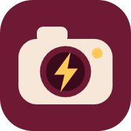
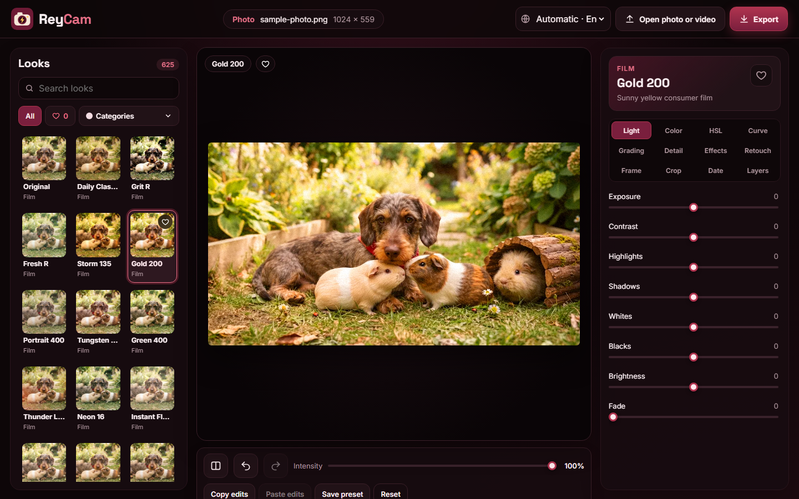
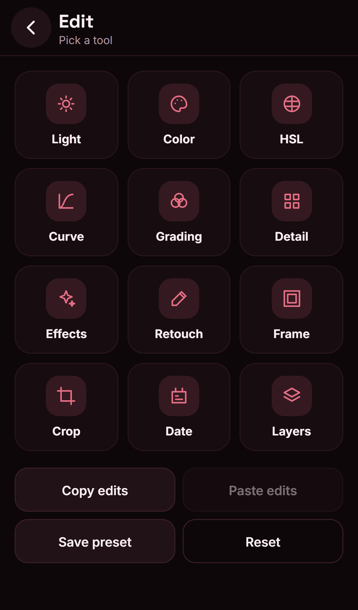
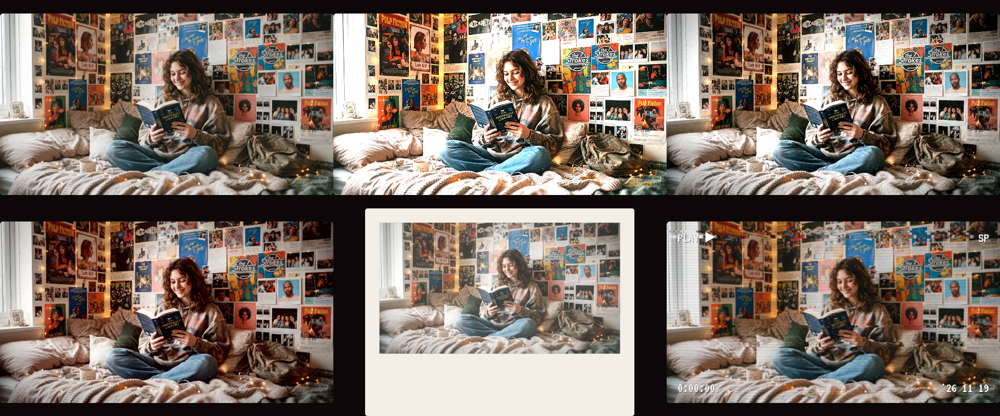
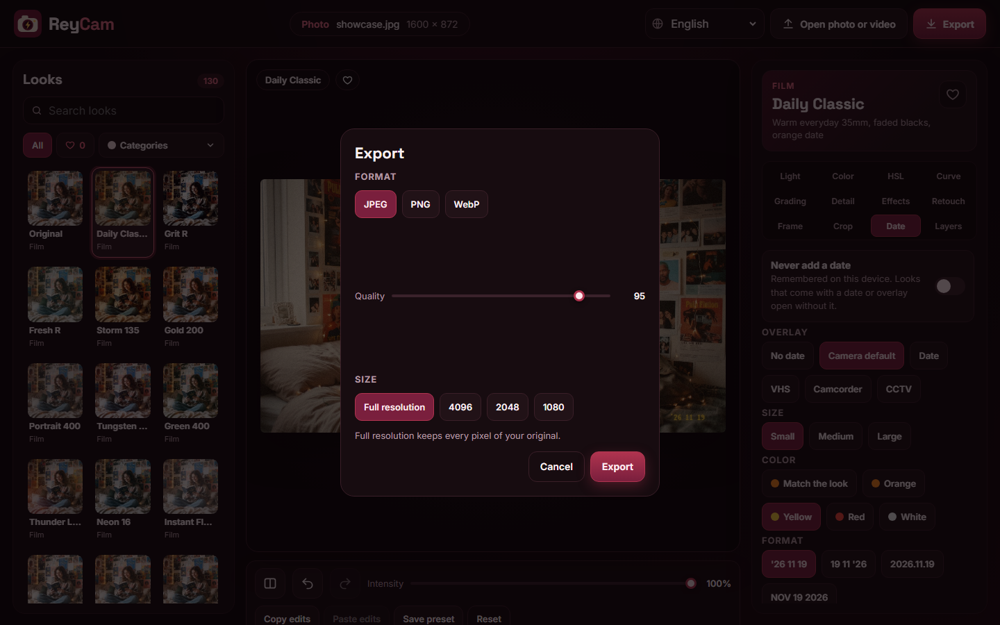
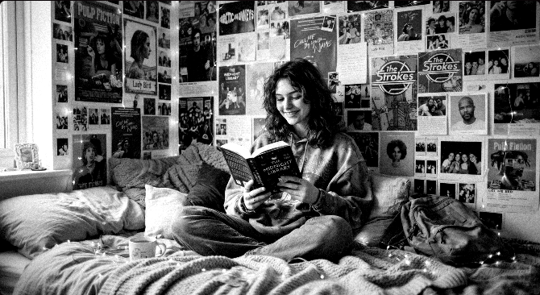
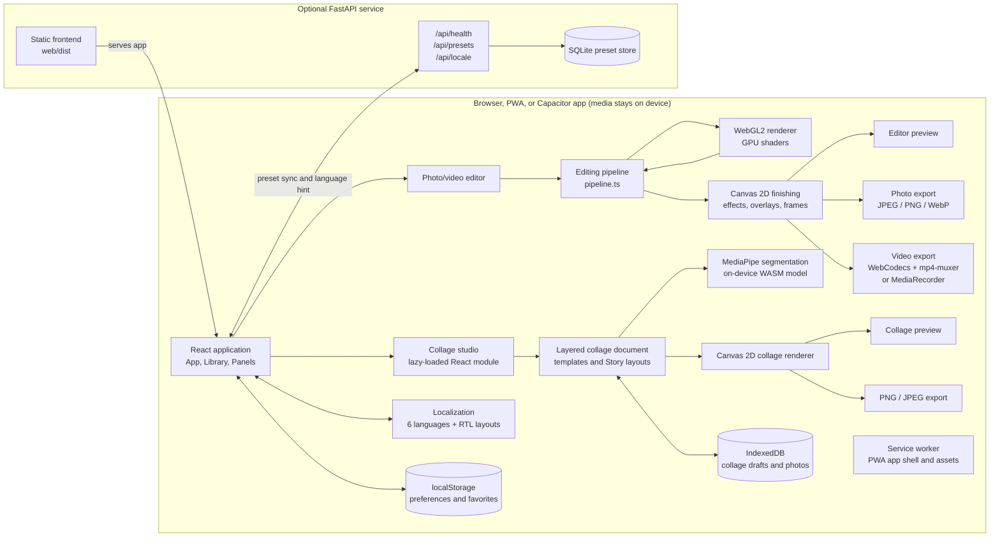
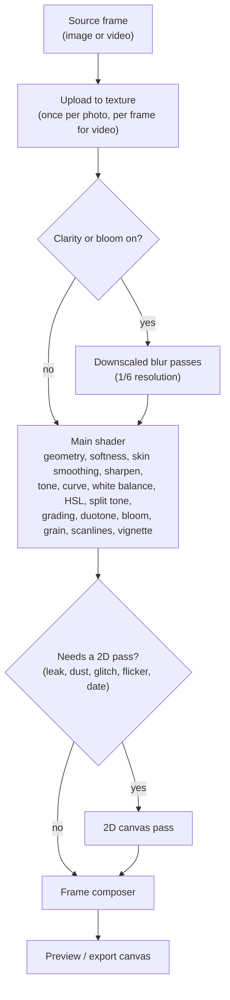

<div align="center">



# ReyCam

**A private, browser-based creative studio for vintage photo and video editing, collage design, and social-ready Stories.**

655 recipes, including Original · 16 categories · 110 collage templates · Multi-photo Stories · WebGL2 rendering · Full-resolution export · Installable PWA · iOS and Android builds · 6 fully translated languages




</div>

---

## Contents

- [Highlights](#highlights)
- [Screenshots](#screenshots)
- [Collage studio](#collage)
- [Looks](#looks)
- [Architecture](#architecture)
- [Getting started](#getting-started)
- [Using ReyCam](#using-reycam)
- [Supported media](#supported-media)
- [Testing](#testing)
- [API](#api)
- [Privacy](#privacy)
- [Project layout](#project-layout)
- [Troubleshooting](#troubleshooting)
- [Contributing](#contributing)
- [Roadmap](#roadmap)
- [License](#license)

## Highlights

- **Two creative workflows.** Edit a single photo or video with camera-inspired looks and professional controls, or switch to **Collage** to build layered scrapbook artwork and multi-photo Stories.
- **On device and private.** Photo and video looks use the device's GPU; collage compositions render locally on canvas. Photos and videos are never uploaded.
- **655 look recipes, including Original, across 16 categories**, including the **Moody** category led by **Mirror Mood** (dark cinematic teal shadows with warm natural skin, fitted to a reference photo) and a **Black and White** category. Looks span film, Y2K, indie, flash, film simulations, low light, nature, yellow, green, wine and more. Each look has an intensity slider, and at 0% it matches the original.
- **Pro adjustments.** Light, parametric tone curve, color, 8 band HSL mixer, three way color grading, clarity, dehaze, sharpen, grain, bloom, light leaks, dust, chromatic shift, scanlines, glitch and lo fi pixels.
- **Camera details.** 10 frames (instant, film strip, slide mount, half frame, 8mm, cinema bars), date stamp in 4 formats and 5 colors, VHS, camcorder and CCTV overlays, double exposure.
- **"No date" everywhere.** A one tap option, plus a remembered setting for people who never want a date, even on looks that ship with one.
- **Instant preview.** The preview redraws in the same frame as the slider moves, and drops resolution only while dragging on slow GPUs.
- **Export.** JPEG, PNG or WebP at full resolution. MP4 (H.264 and AAC) processed frame by frame with WebCodecs, with a real time recorder fallback for older browsers.
- **Favorites, presets and workflow.** Heart any look, save your own presets, copy and paste edits, undo and redo, and hold to compare.
- **Automatic language.** Follows the phone or browser language, then an optional server hint, and can always be changed by hand. English, Portuguese, Spanish, Mandarin, Hindi and German are fully translated. Right-to-left layout is supported for Arabic, Hebrew, Persian and Urdu; untranslated interface text falls back to English.
- **iPhone formats.** HEIC and HEIF photos open everywhere: Safari decodes them natively and other browsers convert them on the device to a full quality JPEG (with the photo's rotation). iPhone `.mov` videos open wherever the device can play HEVC, with a clear tip when it cannot.
- **Built for phones.** A dedicated Home dashboard, a five-item bottom navigation (Home, Filters, Edit, Collage, Import), a quick-filter strip, shortcuts, one-column filter adjustments, separate undo/redo/compare actions, a full-screen photo preview, tool sheets docked under the photo, safe-area spacing, and layouts designed for phone-sized screens. The Import action opens the device picker; it is not a share button.
- **Installable PWA** with an offline app shell.

## Screenshots

The screenshots below are checked-in captures of the application, not mockups. Some older editor and filter captures predate the current Home dashboard; use the screenshot command in [Testing](#testing) to regenerate them after intentional UI changes.

### Welcome screen

The app opens on a Home dashboard with a prominent **Add image** action, recent on-device collage drafts, and links into the existing Collage workspace. The editor header and mobile navigation provide a way back to Home. Exporting remains in the editor header.

<table>
<tr>
<td width="70%"></td>
<td width="30%"></td>
</tr>
</table>

### Phone app (iOS and Android)

On phones the editor gives most vertical space to the preview and keeps navigation in a five-button bar: **Home**, **Filters**, **Edit**, **Collage**, and **Import**. Filters and Edit open focused full-screen panels; Import opens photo, video and camera choices. The editor also has a **Quick filters** strip and shortcuts (Auto, Light, Color, Crop, Frame and Date). The Share/Export action is not duplicated in the bottom bar.

<table>
<tr>
<td width="25%"><br/><sub>Editor (iPhone)</sub></td>
<td width="25%"><br/><sub>Filters page: every look previewed on your photo, categories on top</sub></td>
<td width="25%"><br/><sub>Edit page: pick a tool</sub></td>
<td width="25%"><br/><sub>Sliders docked under the photo, with Done</sub></td>
</tr>
<tr>
<td width="25%"><br/><sub>Upload page: photo, video or camera</sub></td>
<td width="25%"><br/><sub>Editor (Android, Pixel 7)</sub></td>
<td width="50%" colspan="2"><br/><sub>Top: Original, CCD 2003, Indie Sleaze. Bottom: Red Wine, Instant Flash (instant frame), VHS Tape (overlay).</sub></td>
</tr>
</table>

| Date panel with color and "Never add a date" | Compact category menu with favorites |
| --- | --- |
|  |  |

| Export dialog | Black and white look |
| --- | --- |
|  |  |

> Screenshots are captured from the running app with Playwright. The welcome, phone and desktop editor shots use [`docs/screenshots/sample-photo.png`](docs/screenshots/sample-photo.png) as the uploaded photo. The older look and panel shots come from [`web/tests/screenshots.mjs`](web/tests/screenshots.mjs).

## Collage

The **Collage** studio (Portuguese: **Colagem**) is a second, full-screen creative workflow alongside the photo and video editor. It turns one or more photos into scrapbook pages, zines, posters, and social-ready Stories. Subject cutouts and collage rendering run on the device; originals are not uploaded. The editor uses a layered document model, so photos, backgrounds, stickers, text, and drawings can be positioned, transformed, recolored, reordered, locked, duplicated, and removed independently.

- **110 built in templates**, filtered by Stars, Booth, Paper, Doodle, Retro Desktop, Duo, Comic, Scrapbook, Halftone and Nature. Set 1: Star Confetti Booth, Candy Stripe Booth, Cherry Print, Ransom Letters, Red Star Overlay, Crayon Split Duo, Paper Stars Night, Sky Silhouette Split, Doodle Stars Print, Retro Desktop Dialog, System Warning 3D, Retro Paint Frame, Love Wall, Starburst Postcard, Chalk Outline Crew, Ribbon Swirl, Cobalt Duotone Pop and Zigzag Rays. Set 2: Head Bangers, Magazine Profile, Holo Star Frame, Fairy Chase, Forest Elf, Felt Quilt Day, Meet the Artist, Bed Diary, Pink Scribble, Blue Sticker Face, Sunburst Pop, Sketch Aura, Graffiti Night, Memory Halftone, Journal Spiky, Comic Burst, Pattern Patch, Neon Painted, Paint Window Swirl, Desktop Corner, Green Flash Stars, Lime Contact Strip, Eye Strips, Retro Desktop Stack, Blue Monitor Grid, Star Sticker Booth, Sun Doodles, Camera Screen Night, Star Crown, Ribbon Wave Red, Train Diary, Rock Star Poster, Torn Yellow Marker, Sun Rays Party, Couch Sticker Party, Scrapbook Bedroom, Blue Street Board and Blue Burst Zine. Templates take 1 to 5 photos; missing photos reuse the first one. Set 3 (57 to 110, in [`templates-set3.ts`](web/src/collage/templates-set3.ts)) adds party walls, booth strips and grids, film negatives, contact sheets, punched paper, dot and line ornaments, face mosaics, compact camera mockups, frosted glass and riso posters.
- **Tools from set 3** ([`effects2.ts`](web/src/collage/effects2.ts)): photo slices (barcode strips, torn strip shuffle, pixel tiles, glass shards with glitter edges), light leak and prism, grunge paint panels, feature mosaic, dot matrix and line ornaments, punch outs (scattered stars and spirals, oval or star window panels), torn ink threshold patches, frosted glass shapes, crayon face doodles placed on each face, camera playback screen, compact camera mockup, color swatch card, rough white frames, film edge text, double exposure blend, RGB split glow, head portal (soft oval window with vignette), halftone ink strokes, zebra fur, stained glass, tile wall and grunge note backgrounds, and a riso print finish.
- **Filter pairing** ([`filters.ts`](web/src/collage/filters.ts)): after picking photos, a sheet asks "Do you want to use a filter too?" with Use recommended filter, Choose another filter and No filter. The filter is a ReyCam look rendered on each photo slot before the template treatment (70 percent by default), skipped on one or two tone treatments, never on stickers, text or interface elements. It can be changed, dosed or removed in the Photo tab, and the last choice is remembered per template. The recommended Lu filter for each template is in the pairing table; that option turns on as soon as a look with that id (for example `lu-haze`) is added to the looks.
- **Tools from set 2** (Stickers tab, usable in any collage): color block heads (a tinted square behind each head, per face color, size and offset), comic burst bubble, torn magazine page with fake print, sketch overlay from the photo edges with hatching, scribble fill that keeps the person clear, censor bar, crop windows (posterize, invert, tint, with crop guides), pattern patchwork inside the person, thread connectors with pins (uses Weave), photo layouts (grid, strips, contact sheet, filmstrip, torn edge dividers, scanlines), focus boxes, fake camera screen, retro windows and taskbar, liquid contour lines, crayon waves, sun rays, and new doodles (bolt, exclamation, spikes, sun, checker, splat, squiggle, X, circle mark, crown, loops, viewfinder corners).
- **Body features without a second model**: faces, eyes, mouth, hands and feet come from the person mask ([`detect.ts`](web/src/collage/detect.ts)), so face crop zoom, color block heads and focus boxes stay offline. Each photo layer can focus its crop on one of them.
- **Sticker library** ([`stickers.ts`](web/src/collage/stickers.ts), all original drawings, no logos): felt quilt kit (sun, moon, cloud, tree, bee, ladybug, snail, bunny), nature cutouts (goldfish, apple, butterfly wings, mushroom, moss rock, river, tree, pressed flower, tulip sketch) and a sticker pack (plush, sequin, embroidered, chrome and smiling stars, starfish, butterfly, clover, cassette, boombox, dice, cap, headphones, vinyl, compact camera, lips, push pin, ticket, sneaker, planet and more). Any sticker can get a white cut edge or a neon outline.
- **On device cutout** with the MediaPipe Image Segmenter (selfie segmenter, about 250 KB). The model and the WebAssembly runtime ship in `web/public`, so it works offline and photos never leave the device. Refine with restore and erase brushes, a lasso, brush size, softness and zoom.
- **Cutout styles**: clean, paper sticker (outline 0 to 60 px, rough edge, shadow), torn paper, silhouette fill and shape window.
- **Treatments**: black and white, sepia, monotone, duotone, halftone (round or square dots), color overlay (multiply, screen, overlay, normal), warm film, flash, negative tint, posterize, invert, color grade and paint over (neon, ocean or sunset painting with line art and hatching), on the whole photo or only on the cutout. Frames: photobooth, 35 mm film print, Polaroid and white paper.
- **Backgrounds**: solid with felt, kraft, watercolor, grainy poster, recycled, folded, fabric, crumpled, notebook, newsprint, canvas or oil paint texture, stripes, split halves, crayon, painted sky, an original retro desktop scene, felt quilt, retro comic page, ghost repeat, sunburst rays, torn poster, journal pages and your own photo (blur, any treatment, paper texture on top).
- **Stickers and doodles**: holographic, pastel, metallic, pearl and puffy stars, paper stars, starbursts, doodle stars with offset outlines, sparkles, dots, swirls, hearts, embroidered patches, ribbons with the **Weave** tool (tap a segment to pass it behind the person), zigzag rays, **auto outline** around the subject, letter tiles, handwritten text, repeated word patterns and an original 90s style desktop kit (dialogs, icons, pointer, selection, toolbox, recycle bin, folder, paint window). **Scatter** places N stars around the subject while keeping the face clear.
- **Colors**: palette panel with every slot of the collage, a color picker (hue and saturation wheel, brightness, HEX, opacity, recent colors, eyedropper), 12 preset palettes, a shuffle that builds a harmonious palette from the photo, and per element overrides with a relink button.
- **Editor**: ratios 9:16, 4:5, 3:4, 1:1, 4:3 and free, layers panel with thumbnails, undo and redo (60 steps), snapping to the center, autosaved drafts in **My Collages** (IndexedDB), and **Remix** to switch template while keeping the photo and matching colors.
- **Export**: PNG or JPEG at 2160 px on the long side or the photo size when larger, no watermark, optional date stamp, saved to Photos in the native apps and shared or downloaded on the web.

Video collages are planned for a second phase.

### Adding a collage template

Templates are plain data in [`web/src/collage/templates.ts`](web/src/collage/templates.ts) (1 to 18) and [`templates-set2.ts`](web/src/collage/templates-set2.ts) (19 to 56), typed by `CollageTemplate` in [`types.ts`](web/src/collage/types.ts). Add an object to one of those lists, or start a new `templates-setN.ts` and concatenate it in `buildTemplates`:

1. Pick an `id`, a localized `name` (`{ en, pt }`), a `ratio`, filter `tags` and the number of `photos` (1 to 5).
2. Choose a preset `palette` from [`palettes.ts`](web/src/collage/palettes.ts) and override slots in `colors` with the hex values of your reference. List the slots the Colors panel should show first in `slots`.
3. Describe the `layers` from back to front. Positions are fractions of the canvas (`x`, `y` = center, `w` = width), so templates work at any size. Point every color to a slot (`{ slot: 'starPrimary' }`) instead of a fixed color, so palettes and the Colors panel can change it.
4. Use `photo` layers for prints and cutouts, `subject` layers to put the cut out person in front of something drawn over the same photo, and `behind: '<photo layer id>'` on a sticker to hide it behind the person.
5. For crops of a detected feature set `anchor` (`face`, `eyes`, `mouth`, `hands`, `feet`, `body`) and `zoom` on a photo layer. For several photos use a `layout` layer whose `cells` point to photo indexes. Template specific slots (for example `head1`) can be added to `colors`; give them a name in `SLOT_NAMES` in [`strings.ts`](web/src/collage/strings.ts).

No renderer changes are needed. A new tool is a layer kind in `types.ts`, a draw function in [`effects.ts`](web/src/collage/effects.ts) called from `render.ts`, an entry in `TOOLS` (how the Stickers tab creates it) and in `PARAMS` (which settings the editor shows) in [`tools.ts`](web/src/collage/tools.ts), and its labels in `strings.ts`.

### Multi Photo Story

Inside Collage there are two entry points: **Templates** and **Multi Photo Story** (Portuguese: **Story com várias fotos**). The user picks 2 to 30 photos (up to 40 with a warning), reorders them by dragging (or with the arrows on phones), removes them with ×, chooses a style with a live preview, answers the same filter sheet as templates, and edits the result in the collage editor. A **Story** tab regenerates the layout: style, Shuffle, gutter (0 to 40 px), border (0 to 30 px), corner radius (0 to 60 px), shadow, rotation (0 to 20°), density, add or remove photos, and lock a photo so regeneration keeps it in place. Dropping one photo on another swaps them. The Instagram safe zones (top 250 px and bottom 340 px of 1920) show as a dashed overlay that is never exported. Export is 1080 × 1920 or 2160 × 3840 (JPEG or PNG, sRGB, no watermark), with an optional 4:5 feed version (1080 × 1350) laid out again, and **Share to Stories** opens the share sheet (or downloads the file with a message on browsers without file sharing). Photos load as 1440 px previews (1080 px above 12 photos).

Styles: Grid, Mosaic, Messy, Polaroid wall, Photo strip, Film roll, Diagonal, Circles and shapes, Scrapbook and Frame focus. A story is a normal collage document with a `story` field, so drafts, undo, redo, autosave, palettes and filters per photo work the same way.

#### Adding a story style

Styles live in [`web/src/collage/story.ts`](web/src/collage/story.ts). Add an entry to `STORY_STYLES`:

1. `id`, a localized `name`, a recommended `filter` (look id) and optional `defaults` for the options.
2. `generate(photos, canvas, options, seed)`: a pure function that returns `frames` (photo index, center `x` and `y`, `w` and `h` as canvas fractions, `rot`, `shape`, `z`), optional `strips` (photobooth or film strips) and optional `decor` layers. Use `rng(seed)` for randomness so Shuffle only changes the seed, keep faces between `SAFE_TOP` and `1 - SAFE_BOTTOM`, and use `photos[i].faces` and `quality` to pick heroes or avoid covering faces.

The editor, preview, export and tests pick up the new style automatically. `npm run test:story` checks every style from 2 to 30 photos (all photos placed, seeded, under 300 ms, no holes in Grid and Mosaic, no covered faces in Messy and Scrapbook).

### Collage filters (filter pairing fix)

The filter chosen in the "Do you want to use a filter too?" sheet is stored in the collage document (`filter`, plus `slotFilters` per photo) and applied to each photo before the template treatment; stickers, text and interface elements never get it, and the cutout mask is always computed from the original photo. What went wrong before: in the published version the Lu filters did not exist, so "Use recommended filter" was disabled, and the filter pass ran on a separate WebGL context that silently returned the unfiltered photo when the context could not be created or was lost (iOS drops WebGL contexts when the app goes to the background). Now a lost context is recreated, an empty result is retried, and a filter that still cannot run shows a message instead of failing silently. The Photo tab shows the filter of the selected photo with intensity, change, remove, "Apply to all photos" and "Use collage filter". `npm run test:collage` covers recommended, another and no filter, changing the filter after opening, undo and redo, and export matching the preview.

## Looks

| Group | Examples |
| --- | --- |
| Film | Daily Classic, CP 35, NE 135, SR 135, Golf Pastel, KV 88, S 67, D Expired, 1998, CT 2F, Nostalgia, Hoga, Sprocket, Okak, FQS, Pola I, Inst Mini, Mono 400, Medium 120, Dispo 27 |
| Indie | Indie Sleaze, Indie Core, Overblown, Flash 2020, Blown Out, Bad Flash, Pink Blowout, Webcam 2020, Tumblr 2014, Bedroom Pop, Grunge 90 |
| Y2K | Y2K Flash, CCD Blue, CCD 2003, Glow Party, Digi 2000, Phone 2010, Myspace |
| Simulations | Vivid 50, Standard 100, Soft Portrait, Chrome Calm, Super Neg, Amber Neg, Cine Soft, Bleach, Fine Mono, True Color |
| Yellow | Honey, Sunflower, Amber 70, Lemon Pastel, Summer Sun, Mustard |
| Green | Emerald, Cold Forest, Mint, Retro Olive, Drugstore Green, Neon Green |
| Wine | Red Wine, Bordeaux, Cherry Noir, Rose, Merlot Film, Velvet |
| Flash, Low light, Nature, Colors, Video, Extras | Paparazzi, Neon Noir, Golden Hour, Ultra Violet, VHS Tape, Super 8, Fisheye, Prism, Night Vision and more |

Look names are original. Several looks are inspired by classic film stocks and popular retro camera apps, without using their names or logos.

### LU and Gu filters

The **LU** category has 24 looks whose names start with "Lu" (Lu Haze, Lu Flash and Lu Glitter first, with a star badge), including **Lu Amora, Lu Pitaya, Lu Goiaba, Lu Melancia, Lu Morango and Lu Framboesa**. The **Indie** category starts with six "Gu" looks (lightning badge): Gu Candle, Gu Soirée, Gu Amber, Gu Bronze, Gu Ember and Gu Dusk. They use the same data driven engine as every other look, with extra GPU stages (gradient map, posterize, threshold with dithering, halftone, print streaks and specks, flash falloff centered on the head, skin protection, colored and shadow weighted grain) and person mask effects drawn after the GPU pass (glitter only on the background, star flares, synthetic flash shadow; without a mask they fall back to the whole image at lower strength). Each look has quick adjustments under the intensity slider. The six fruit looks use luminance gradient maps (with posterization on Lu Pitaya), mixed with the original where needed, plus GPU grain and color grading for their requested film palettes. Grain is generated per pixel at output resolution and changes every frame on video. The looks are evaluated directly on the GPU at full precision, so no baked LUT files are needed.

#### Adding a Lu or Gu filter

Add one entry to `LU_LOOKS` or `GU_LOOKS` in [`web/src/engine/recipes-lu.ts`](web/src/engine/recipes-lu.ts): `id` (`lu-...` or `gu-...`), `name`, `cat` (`lu` or `indie`), optional `badge`, `desc`, the parameters (same slider scale as the other looks, exposure 60 = 1 EV, `gmap` stops, `poster`, `thresh`, `halftone`, `flash`, `glitter`, `flares`, `flashShadow`...) and `quick` adjustments (`range` maps a slider to parameters, `choice` picks an option such as an alternate `gmapAlts` palette, `shuffle` changes the sparkle seed). Add the Portuguese description to `web/src/i18n/locales/pt.json` and any new quick adjustment label to `QUICK_LABELS`. Lu looks are offered first in the collage filter sheet, and the recommended pairing per template is in [`web/src/collage/filters.ts`](web/src/collage/filters.ts).

## Architecture

ReyCam is a client-first TypeScript application with a small optional Python API. The browser or installed app owns media decoding, editing, rendering, and export. The API does not receive image or video files: it only serves the built frontend and provides locale suggestions and shared preset storage.



### Main components

- **React application (`web/src/App.tsx`)** owns the app shell, editing state, media selection, editor controls, and navigation. The Collage studio is loaded on demand, keeping its editor code out of the initial application path.
- **Photo and video engine (`web/src/engine/`)** combines data-driven look recipes with a WebGL2 shader pipeline for image adjustments. A Canvas 2D finishing stage composites effects, overlays, dates, and frames. The same pipeline serves preview and export, with output size as the primary difference.
- **Collage engine (`web/src/collage/`)** represents a design as a document containing ordered layers and named palette slots. Template and Story data describe compositions; a Canvas 2D renderer draws previews and exports. MediaPipe's locally bundled segmentation model creates subject masks, which can be refined in the editor. Draft documents, their source photos, and masks are stored in IndexedDB.
- **Platform and persistence** include browser storage for lightweight preferences and favorites, IndexedDB for collage drafts, the service worker for the PWA shell, and Capacitor for native iOS/Android packaging and gallery export.
- **FastAPI backend (`server/`)** serves the compiled frontend in self-hosted deployments and exposes health, locale-hint, and preset endpoints. Presets are stored in SQLite; this API is optional for deployments that serve the frontend elsewhere. It is not a media-processing or media-upload service.

### Render pipeline



**Key ideas**

- Every look is a *recipe*: plain numbers on the same scale as the user sliders. Effective value = recipe value × intensity + user edit, so looks and manual edits always combine predictably.
- The preview and the exports share one pipeline. Only the output size changes, so what you see is what you export.
- Video export seeks each source frame, renders it at full resolution and encodes it with its exact timestamp, so slow devices never drop frames. Audio is copied from the original file.

## Getting started

ReyCam has two deployment modes: the static web application can run without the Python API, while the optional API provides a shared preset store and a language hint. The public GitHub Pages deployment is static and does not provide the API-backed shared preset service.

### Prerequisites

- Node.js 20 or later and npm for frontend development and builds. The Pages workflow uses Node.js 22; the Docker image uses Node.js 20 for its build stage.
- Python 3.9 or later and pip for the API (the Docker runtime uses Python 3.12).
- A modern browser with WebGL2 for the photo/video editor. Collage subject cutout uses the locally bundled MediaPipe model and WASM runtime.
- Docker Engine only if using the container instructions below.

Clone the repository and enter its root before following the commands:

```bash
git clone https://github.com/GUTOMADON/reycam.git
cd reycam
```

### Option 1: Python server (serves the prebuilt frontend when available)

Requires Python 3.9 or newer.

```bash
cd server
pip install -r requirements.txt
python -m uvicorn main:app --host 0.0.0.0 --port 8000
```

Run these commands from the repository root. The API process serves `web/dist` when that directory exists; build it first if you want the Python process to serve the web UI:

```bash
cd web
npm ci
npm run build
cd ..
python -m uvicorn main:app --app-dir server --host 127.0.0.1 --port 8000
```

Open http://127.0.0.1:8000. The repository-root convenience scripts are `start.bat` on Windows and `./start.sh` on macOS/Linux; inspect them for their exact local setup behavior before using them.

To run only the API while developing the frontend, start the API from the root with the same `uvicorn` command and use the Vite dev server in the next section. Vite proxies `/api` to `http://localhost:8000`.

### Option 2: Docker

```bash
docker build -t reycam .
docker run -p 8000:8000 reycam
```

### Option 3: Develop the frontend

Requires Node.js 18 or newer.

```bash
cd web
npm install
npm run dev        # hot reload on http://localhost:5173, proxies /api to port 8000
npm run build      # checks translations, type checks and writes web/dist
npm run preview    # preview the production build locally
```

The Pages workflow builds with `--base=/reycam/`. `web/index.html` uses Vite's `%BASE_URL%` placeholder for public icons, the manifest and the public font stylesheet; the application uses `import.meta.env.BASE_URL` for the service worker, sample image and segmentation assets. For another repository path, pass the matching base when building, for example `npm run build -- --base=/your-repository/`.

### Environment variables

The frontend has no required `.env` file. Its `/api` development proxy target is configured in `web/vite.config.ts` as `http://localhost:8000`. The backend reads:

| Variable | Default | Purpose |
| --- | --- | --- |
| `REYCAM_DB` | `server/reycam.db` | SQLite file used for shared presets. |
| `REYCAM_DIST` | `web/dist` | Static frontend directory served by FastAPI when present. |

The API also reads standard request headers (`Accept-Language` and supported CDN country headers) to suggest a language; no external geolocation service is called.

### Docker

From the repository root:

```bash
docker build -t reycam .
docker run --rm -p 8000:8000 -v reycam-data:/data reycam
```

The named volume keeps the SQLite preset database at `/data/reycam.db` across container replacement. Open http://127.0.0.1:8000.

### Android app (APK)

Download the latest [**ReyCam.apk**](https://github.com/GUTOMADON/reycam/releases/latest/download/ReyCam.apk). The [Android workflow](.github/workflows/android-apk.yml) builds it on every push and publishes it as a GitHub Release. Open the APK on the phone, allow **Install unknown apps** for the browser or file manager, and install. Exports are saved to a **ReyCam** album in the gallery. CI builds use a debug signing key; Android may require uninstalling an older build before installing a newer one.

### iPhone profile (`.mobileconfig`)

[`docs/install/ReyCam.mobileconfig`](docs/install/ReyCam.mobileconfig) (also on the release and at `https://gutomadon.github.io/reycam/ReyCam.mobileconfig`) is an iOS configuration profile that adds ReyCam to the Home Screen with its icon, full screen. Open it in Safari, then go to **Settings → Profile Downloaded → Install**. It needs no computer and no Apple ID, never expires, and can be removed in **Settings → General → VPN & Device Management**. Regenerate it with `cd web && node scripts/make-mobileconfig.mjs [url]`.

### Install on iPhone from a link (recommended)

The app is published on GitHub Pages by [`.github/workflows/pages.yml`](.github/workflows/pages.yml) on every push: **https://gutomadon.github.io/reycam/**

1. Open the link in **Safari** on the iPhone (not Chrome).
2. Tap **Share** → **Add to Home Screen** → **Add**.

ReyCam gets its own icon, opens full screen like a native app, works offline after the first visit, and never expires. Share the same link with anyone to let them install it.

### Install on iPhone as a native app (IPA, no App Store)

An `.ipa` cannot be installed by tapping it on the iPhone: iOS only installs apps signed for that device. Use a computer and the steps below.

Every push to `main` runs [`.github/workflows/ios-ipa.yml`](.github/workflows/ios-ipa.yml) on a macOS runner. It builds the Capacitor iOS app with the ReyCam logo as the app icon, and publishes an unsigned **`ReyCam.ipa`** on the [Releases page](../../releases). In the native app, **Export saves photos and videos straight to the Photos gallery**.

1. Download `ReyCam.ipa` from the latest **iOS build** release.
2. Install [Sideloadly](https://sideloadly.io) on Windows or macOS (iTunes or Apple Devices must be installed on Windows), plug in the iPhone, drop the IPA in and sign in with your Apple ID.
3. On the iPhone, trust your Apple ID in **Settings → General → VPN & Device Management**, and on iOS 16 or later turn on **Settings → Privacy & Security → Developer Mode**.

With a free Apple ID the app has to be reinstalled every 7 days (AltStore can refresh it automatically). A paid Apple Developer account removes the limit and allows TestFlight.

To regenerate the icon and splash after changing the logo: `cd web && node scripts/make-app-assets.mjs`.

### Install on a phone

Phones need HTTPS for the gallery picker and file export (localhost is exempt on computers). Deploy the server behind HTTPS, or test with a tunnel such as `cloudflared tunnel --url http://localhost:8000`, then use **Add to Home Screen** (iOS Safari) or **Install app** (Android Chrome).

## Using ReyCam

1. Open the Home screen and choose **Add image** to select media. On desktop, image files can also be dropped onto the app.
2. Choose a look from the filter gallery or use the quick-look strip. The selected look is highlighted; intensity and editor controls are available alongside the preview.
3. Open **Edit** to choose a panel such as Light, Color, HSL, Crop, Frame, Stamp, Retouch or Layers. The Home button returns to the dashboard.
4. Use **Collage** to open templates or Stories. Collage drafts autosave locally in IndexedDB and can be reopened from the Home dashboard or the Collage gallery on the same browser/device.
5. Use **Export** in the header to choose output settings. Depending on the browser/platform, a file is downloaded, shared, or saved to the device gallery.

The mobile bottom bar's **Import** action opens photo, video and camera input choices; it is not a share action. Sharing/export remains in the existing export flow to avoid duplicate actions. The website cannot enumerate images already saved into a phone's Photos/Gallery library, so it does not present those exports as an in-app photo library.

## Supported media

| Input | Import behavior | Export behavior |
| --- | --- | --- |
| JPEG, PNG, WebP | Open in the single-image editor; HEIC/HEIF is accepted and decoded natively where supported or converted on-device where possible. | JPEG, PNG or WebP at a selected output size/quality. |
| HEIC/HEIF | Safari may decode natively; other supported browsers use the on-demand `heic-to` converter. Conversion is local to the device. | Export uses the selected JPEG/PNG/WebP format. |
| MP4, MOV and other browser-decodable video | Open with playback controls. Actual codec support depends on the browser and device; unsupported HEVC/MOV media may not decode. | MP4 when WebCodecs is available, otherwise the MediaRecorder fallback where supported. |
| Collage/Story photos | Imported into the collage document; cutout segmentation is performed locally. | PNG or JPEG. |

The file picker advertises common image and video types, but container and codec support is ultimately determined by the platform decoder. The app does not upload source media to the API.

## Look lab

`web/tests/lab/run.mjs` renders looks with the real pipeline in Chromium:

```bash
npm run lab:counts
```
Shows how many looks each category has.

```bash
npm run test:looks
```
Fails when two looks have almost identical thumbnails.

```bash
npm run lab:mirror
```
Shows how close each Moody look is to the Mirror Mood reference (mean delta E per pixel).

HEIC photos open in every browser: Safari decodes them natively and other browsers load `heic-to` (LGPL-3.0) on demand.

## Testing

| Suite | Command | What it covers |
| --- | --- | --- |
| Translations | `cd web && npm run test:i18n` | Fails if any UI string or look description is missing in pt, es, zh, hi or de |
| API | `python -m pytest server` | Health, presets round trip, invalid payloads (400 and 413), `/api/locale` variants and country header |
| End to end | `cd web && npm run test:e2e` | Opening media (button, drag and drop, paste, JPEG, PNG, WebP, MP4, MOV, invalid file, HEIC), every look on a photo and a video, intensity, every panel and slider, undo and redo, presets, photo and video export checked with ffprobe, playback, "No date", automatic language, phone and desktop layouts, PWA, accessibility and console |
| Mobile editor | `cd web && npm run test:mobile` | 360/390/430 px touch layouts, quick-filter sliders and color chips, overflow, fullscreen close/escape/backdrop, and six new looks across light and portrait photos |
| Date color | `cd web && node tests/date-color.test.mjs` | Reads the pixels of the date for every color in the preview, the photo export and the video export, on desktop, iPhone and Android profiles |
| Screenshots | `cd web && node tests/screenshots.mjs` | Regenerates the images in `docs/screenshots` |
| Collage filters | `cd web && npm run test:collage` | Recommended/alternate/no filter, changes, undo/redo and export-preview consistency |
| Stories | `cd web && npm run test:story` | Story layout generation and browser export behavior |
| Recipe diversity | `cd web && npm run test:library` | Category counts and rendered-look similarity checks; this is a catalog quality audit and can flag existing near-similar looks |

The browser suites use Playwright with installed Google Chrome (`CHANNEL=chrome`) and a running app server. `tests/e2e.mjs` defaults to `http://localhost:8010`; the collage and Story suites default to Vite at `http://localhost:5173`. Set `BASE` to override a suite's default. Start the Vite server with `cd web && npm run dev -- --host 127.0.0.1 --port 5173`. The API suite requires the Python test dependencies from `server/requirements.txt` plus pytest. Fixtures are checked into `web/tests/fixtures`; do not replace them with user media.

For a layout-focused E2E run against Vite, use `BASE=http://127.0.0.1:5173 ONLY=layout npm run test:e2e` (PowerShell: `$env:BASE='http://127.0.0.1:5173'; $env:ONLY='layout'; npm run test:e2e`). The E2E layout branch checks iPhone/Android profiles and desktop columns; the six reference widths in a manual viewport audit are 320, 375, 390, 430, 768 and 1366 pixels.

## API

Run the API from the repository root with `python -m uvicorn main:app --app-dir server --host 127.0.0.1 --port 8000`, or from `server/` with `python -m uvicorn main:app --host 127.0.0.1 --port 8000`.

| Method | Path | Purpose |
| --- | --- | --- |
| GET | `/api/health` | Health check |
| GET | `/api/locale` | Suggested UI language from `Accept-Language` and an optional CDN country header (`CF-IPCountry`, `X-Vercel-IP-Country`, `CloudFront-Viewer-Country` and others). No external geolocation service is used |
| GET | `/api/presets` | List saved presets |
| PUT | `/api/presets` | Replace the saved preset list. Validates shape, at most 500 presets and 2 MB per request |

Presets are stored in SQLite (`server/reycam.db`, change with `REYCAM_DB`). There are no user accounts yet, so one server holds one shared preset list. Add authentication or per device IDs before exposing it to many users.

Quick health check:

```bash
curl http://127.0.0.1:8000/api/health
```

Expected response: `{"status":"ok","app":"ReyCam"}`. `/api/locale` returns a language suggestion from request headers; `/api/presets` reads the shared list and `PUT /api/presets` replaces it. The API validates the JSON shape, allows at most 500 presets and limits request bodies to 2 MB. GitHub Pages is static hosting, so its deployment does not expose these API routes or shared preset synchronization.

## Privacy

- Photos and videos are processed locally and never sent to the server.
- Collage drafts, source photos, and segmentation masks are saved in the browser's local IndexedDB storage so they can be reopened on the same device.
- The server only stores presets (edit settings, no images) and reads request headers to suggest a language.
- Favorites, language and the "No date" setting live in the browser's localStorage.

## Project layout

```
web/                    React + TypeScript + Vite app (PWA)
  src/engine/           WebGL2 renderer, pipeline, recipes, video exporter
  src/collage/          templates, Story layouts, layer editor and 2D renderer
  src/components/       Library (looks, favorites, categories), panels, logo
  src/i18n/locales/     en, pt, es, zh, hi, de
  public/               icons, manifest, service worker, fonts.css, fonts, sample media and segmentation assets
  tests/                Playwright suites, i18n test, fixtures
  dist/                 prebuilt app served by the server
server/                 FastAPI app, SQLite preset storage and API tests
docs/screenshots/       README screenshots
.github/workflows/      GitHub Pages, Android APK and iOS IPA workflows
Dockerfile
start.bat / start.sh    Local convenience launch scripts
```

## Troubleshooting

- **Blank preview or WebGL error:** update the browser/graphics driver, enable hardware acceleration and confirm WebGL2 is available. Some remote/virtual desktops disable GPU contexts.
- **A video will not open:** browser codec support varies. Try an H.264 MP4 if a MOV/HEVC file cannot decode; this is a platform decoder limitation rather than a server upload issue.
- **HEIC conversion fails:** try Safari on Apple devices or convert the source to JPEG locally. HEIC conversion is performed on-device and depends on the browser/runtime.
- **Collage cutout is unavailable:** allow the bundled WASM/model assets to load and use a browser with WebAssembly support. The collage editor can continue with non-segmented photos if segmentation is unavailable.
- **Shared presets/API fail on GitHub Pages:** Pages serves the static frontend only. Run the FastAPI service and configure a deployment that serves `/api` if shared presets or server locale hints are required.
- **Custom Pages path gives missing icons/fonts:** build with a base path matching the repository URL, e.g. `npm run build -- --base=/reycam/`. The Pages workflow sets this automatically from the repository name.
- **Phone file picker/export does not appear:** use HTTPS or localhost and grant the browser's file/photo permissions. Native gallery saving depends on the platform and permissions; web browsers may download or open the share sheet instead.

## Contributing

1. Create a branch and keep changes scoped to one behavior or documentation area.
2. Install web dependencies with `cd web && npm ci` and, when working on the API, install `server/requirements.txt` in a virtual environment.
3. Before opening a pull request, run `npm run build`, the relevant browser suite(s), and `python -m pytest server` for API changes. Browser tests require the server specified in their suite documentation.
4. Update translations in all supported locale bundles when adding interface strings; `npm run test:i18n` checks key coverage.
5. For new looks, templates or Story styles, update their data sources and corresponding rendering/regression tests. Avoid adding screenshots or media unless they are required, licensed for the repository and reproducible.

## Roadmap

- 3D LUT (.cube) support and LUT based film looks
- Live camera mode with real time looks
- Faster video export with WebCodecs decoding
- Per device private presets and optional accounts
- Social presets (Stories, Reels, feed) with safe area guides
- Batch editing, local adjustments, point tone curve, live histogram

## License

Code: [MIT](LICENSE).

Fonts: Inter, Space Grotesk and VT323 under the SIL Open Font License, bundled from Fontsource. MP4 muxing by [mp4-muxer](https://github.com/Vanilagy/mp4-muxer) (MIT).

The showcase photo in the screenshots and tests is an illustrative image provided by the project owner for demonstration. The posters and artwork visible in it belong to their respective owners and are not part of this project.
